# Cursed Equipment

Ten pieces of cursed equipment join the Blacksmith's stock in Super Fantasy Kingdom. Each gives its wearer an advantage and a drawback. A plum-and-crimson smith's frame identifies cursed offers at a glance.

## Features

- Ten rare items with original pixel-art icons and the same plum-and-crimson card treatment as Cursed Relics, with native focus and rarity.
- The cards show each Gift and the red Curse together. Rarity markers and prices use the game's usual controls.
- Cursed offers highlight Buy on hover, focus, or press. Unaffordable offers show how much more you need.
- Effects follow the wearer. Copies occupy ordinary equipment slots and their effect applies once.
- Equipped pieces and dropped items persist through the native kingdom save.
- Equipment pairs can work together. Spellglass and Mirror apply their multipliers to the same qualifying hit.

## How to Use

1. Visit the Blacksmith and inspect the Gift and Curse before buying. The ten items join the game's normal stock rotation.
2. Equip a purchase using the game's item controls. Use the Magnet to remove and redistribute gear.
3. Keep Cursed Equipment enabled when continuing a kingdom containing its items.
4. The Blacksmith rotation determines equipment availability. The optional Cursed Relics chance setting governs its own eligible chest rewards.

## Screenshots

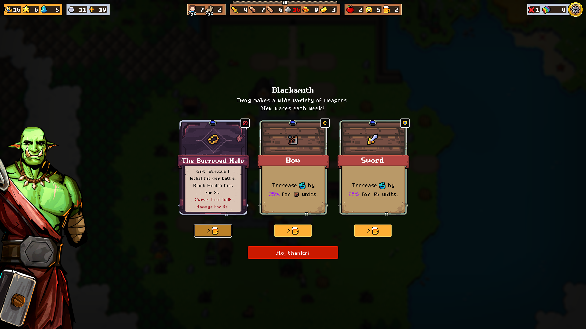

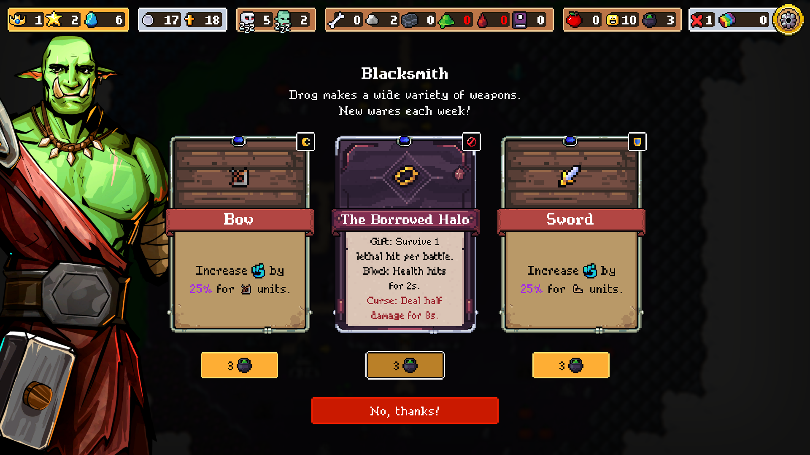

All ten Blacksmith cards appear below at 1.5× UI scale. Each Gift and Curse is also available as selectable text.

### Cracked Spellglass

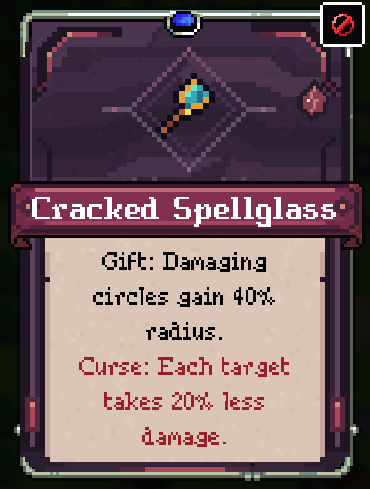

**Gift** Damaging circles gain 40% radius.

**Curse** Each target takes 20% less damage.

### Bitter Chalice

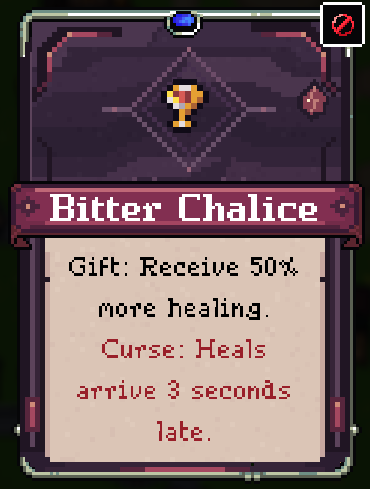

**Gift** Receive 50% more healing.

**Curse** Heals arrive 3 seconds late.

### Cracked Duelist's Mirror

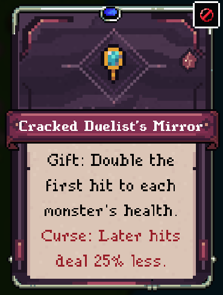

**Gift** Double the first hit to each monster's health.

**Curse** Later hits deal 25% less.

### Duelist's Fang

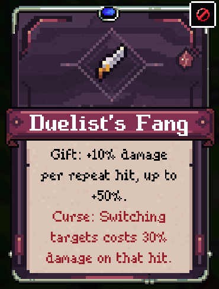

**Gift** +10% damage per repeat hit, up to +50%.

**Curse** Switching targets costs 30% damage on that hit.

### Martyr's Plate

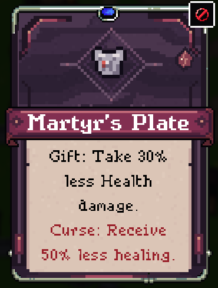

**Gift** Take 30% less Health damage.

**Curse** Receive 50% less healing.

### Gravedigger's Lantern

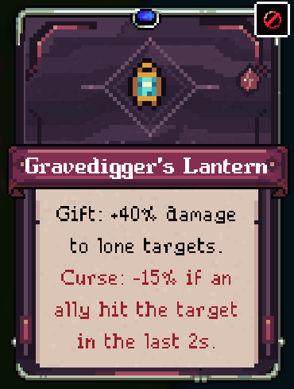

**Gift** +40% damage to lone targets.

**Curse** -15% if an ally hit the target in the last 2s.

### Hangman's Quarrel

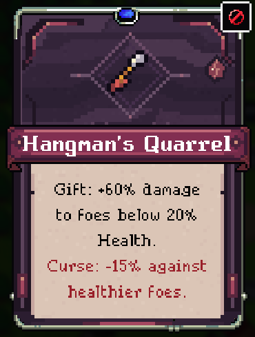

**Gift** +60% damage to foes below 20% Health.

**Curse** -15% against healthier foes.

### Emberwake Blade

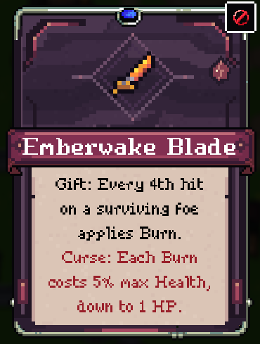

**Gift** Every 4th hit on a surviving foe applies Burn.

**Curse** Each Burn costs 5% max Health, down to 1 HP.

### Leadheart Locket

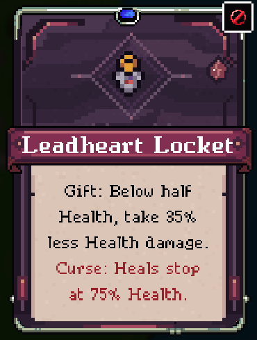

**Gift** Below half Health, take 35% less Health damage.

**Curse** Heals stop at 75% Health.

### The Borrowed Halo

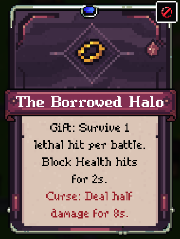

**Gift** Survive 1 lethal hit per battle. Block Health hits for 2s.

**Curse** Deal half damage for 8s.

## Compatibility

- Tested on Super Fantasy Kingdom **0.8.070** alongside the other [GKJ mods](https://thunderstore.io/c/super-fantasy-kingdom/p/GKJ/).
- [Cursed Relics](https://thunderstore.io/c/super-fantasy-kingdom/p/GKJ/CursedRelics/), [Nights of Terror](https://thunderstore.io/c/super-fantasy-kingdom/p/GKJ/NightsOfTerror/), and [Hold the Line](https://thunderstore.io/c/super-fantasy-kingdom/p/GKJ/HoldTheLine/) are optional. Cursed Relics affects your run, and cursed equipment affects its wearer.
- Cursed Equipment uses the native equipment slots, restrictions, item pickups and saves. Losing the last Bitter Chalice or dying cancels pending heals.
- Spellglass affects damaging circular projectile searches. Fang, Lantern, Quarrel and Emberwake use qualifying unit hits that reach enemy Health. Plate, Locket and Halo apply to Health damage after the wall and Shields.
- Tested alongside [Achievement Enabler](https://thunderstore.io/c/super-fantasy-kingdom/p/ownlyme/AchievementEnabler/), [Bakery Uses Wheat](https://thunderstore.io/c/super-fantasy-kingdom/p/ownlyme/BakeryUsesWheat/), [More Relics](https://thunderstore.io/c/super-fantasy-kingdom/p/ownlyme/MoreRelics/), [Right Click Skip](https://thunderstore.io/c/super-fantasy-kingdom/p/ownlyme/RightClickSkip/), and [Tavern Food Priorities](https://thunderstore.io/c/super-fantasy-kingdom/p/ownlyme/TavernFoodPriorities/).

## Installation

1. In Thunderstore Mod Manager or r2modman, open a **Super Fantasy Kingdom** profile.
2. Install **CursedEquipment** by **GKJ**. Allow the manager to install [BepInExPack](https://thunderstore.io/c/super-fantasy-kingdom/p/BepInEx/BepInExPack/) and [HideManagerGameObject Config](https://thunderstore.io/c/super-fantasy-kingdom/p/BepInEx/HideManagerGameObject_Config/).
3. Select **Start modded** and visit the Blacksmith. For manual installation, place `plugins/CursedEquipment.dll` from the ZIP in your profile's `BepInEx/plugins` directory.

## Support

[Support GKJ Games on Ko-fi](https://ko-fi.com/gkj_games)

## Development

See the [contribution guide](CONTRIBUTING.md) for builds, tests and issue reports. The [0.2.3 playtest notes](docs/release-0.2.3/README.md) document the earlier 0.8.068 copied-kingdom tests. The original mod code is available under the [MIT License](LICENSE). Super Fantasy Kingdom and its assets retain their respective ownership.
