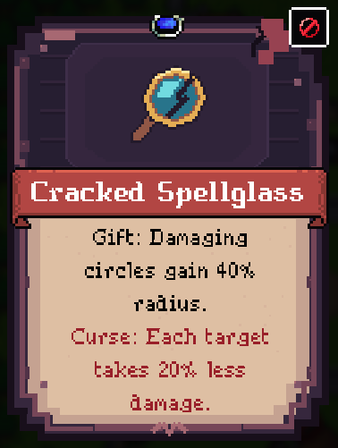
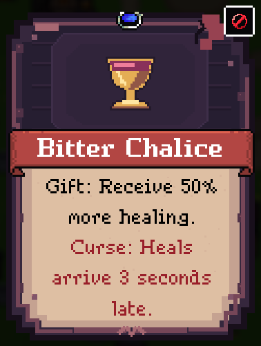
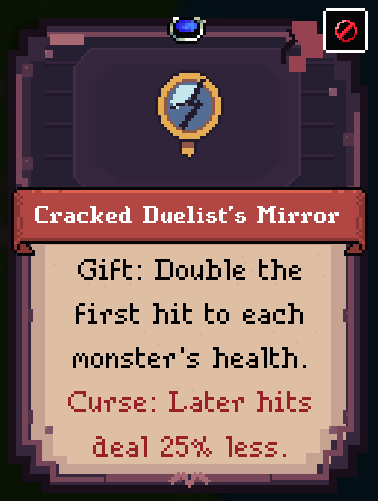
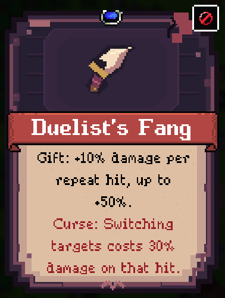
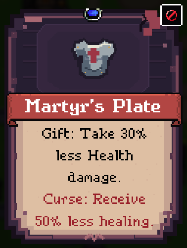
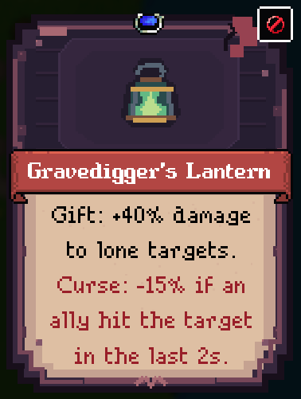
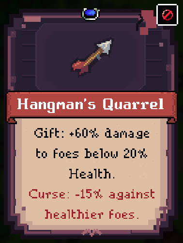
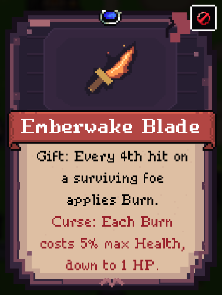
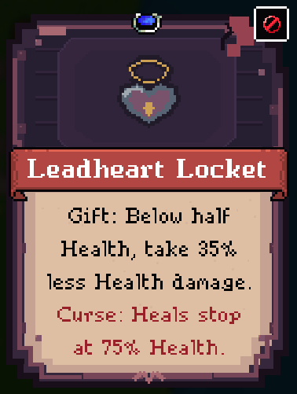
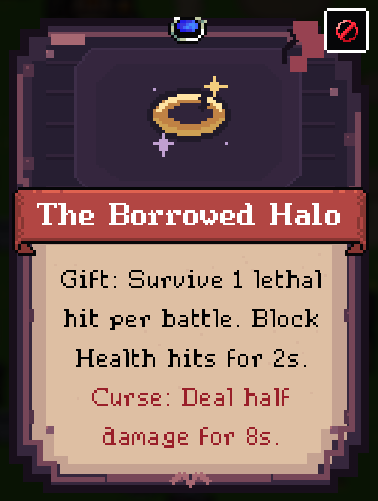

# Cursed Equipment

Ten pieces of cursed equipment join the Blacksmith's stock in Super Fantasy Kingdom. Each gives its wearer an advantage and a drawback. A plum-and-crimson smith's frame identifies cursed offers at a glance.

## Features

- Ten rare items with original pixel-art icons and a custom frame with riveted rails, a broken corner, and distinct hover and focus states.
- The cards show each Gift and the red Curse together. Rarity markers and prices use the game's usual controls.
- Effects follow the wearer. Copies occupy ordinary equipment slots and their effect applies once.
- Equipped pieces and dropped items persist through the native kingdom save.
- Equipment pairs can work together. Spellglass and Mirror apply their multipliers to the same qualifying hit.

## How to Use

1. Visit the Blacksmith and inspect the Gift and Curse before buying. The ten items join the normal rotating stock.
2. Equip a purchase using the game's item controls. Use the Magnet to remove and redistribute gear.
3. Keep Cursed Equipment enabled when continuing a kingdom containing its items.

## Screenshots

All ten Blacksmith cards appear below at 1.5× UI scale. Each Gift and Curse is also available as selectable text.

### Cracked Spellglass

**Gift** Damaging circular projectile searches have 40% more radius.

**Curse** Each qualifying damage effect deals 20% less damage per target.

### Bitter Chalice

**Gift** The wearer receives 50% stronger health heals and overheals.

**Curse** Each heal arrives three game seconds later. Death or losing the last Chalice cancels pending heals.

### Cracked Duelist's Mirror

**Gift** The wearer's first hit that reaches each monster's health deals double damage.

**Curse** Each later hit by that wearer deals 25% less damage to that monster.

### Duelist's Fang

**Gift** Repeat hits on the same monster gain 10% damage each, up to 50%.

**Curse** The first hit after switching targets deals 30% less damage.

### Martyr's Plate

**Gift** The wearer takes 30% less Health damage.

**Curse** The wearer receives 50% less health healing.

### Gravedigger's Lantern

**Gift** Deal 40% more damage to a target no other ally has hit in the past two game seconds.

**Curse** Deal 15% less damage if an ally hit that target during the window.

### Hangman's Quarrel

**Gift** Deal 60% more damage against monsters below 20% Health.

**Curse** Deal 15% less damage against healthier targets.

### Emberwake Blade

**Gift** Every fourth qualifying hit applies Burn to the surviving monster.

**Curse** Each trigger costs 5% of the wearer's maximum Health, down to a floor of 1 HP.

### Leadheart Locket

**Gift** Take 35% less Health damage below half Health.

**Curse** Health healing stops at 75% of maximum Health. Existing Health above that threshold is retained.

### The Borrowed Halo

**Gift** Once per battle, survive a lethal Health hit and block further Health damage for two game seconds.

**Curse** After surviving, damage to monsters is halved for eight game seconds.

## Compatibility

Cursed Equipment uses the native equipment slots, restrictions, Blacksmith and item saves. Spellglass affects circular projectile searches that deliver native damage effects. Fang, Lantern, Quarrel and Emberwake use unit-sourced hits that reach enemy Health. Burn and other status ticks skip those four effects. Emberwake applies native Burn and requires a living wearer with positive Health.

Plate, Locket and Halo apply to the wearer's remaining Health damage after the wall and Shields. Chalice delays health heals and overheals by three simulation seconds. Losing the last Chalice or dying cancels pending heals. Continue restores equipment and starts a new combat state.

## Installation

1. In Thunderstore Mod Manager, open a Super Fantasy Kingdom profile with BepInEx. Import the local archive, or install Cursed Equipment once the listing is available.
2. Select **Start modded**. For manual installation, place `plugins/CursedEquipment.dll` from the archive in the profile's `BepInEx/plugins` directory.

### Build locally

Run `dotnet build CursedEquipment.csproj -c Release` followed by `python package.py`. Override the default installed paths with `GameDir` and `ProfileDir` when needed.

## Support

[Support GKJ Games on Ko-fi](https://ko-fi.com/gkj_games)
