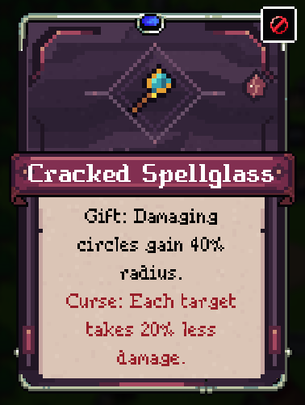
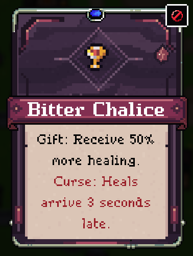
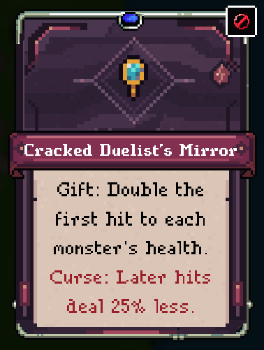
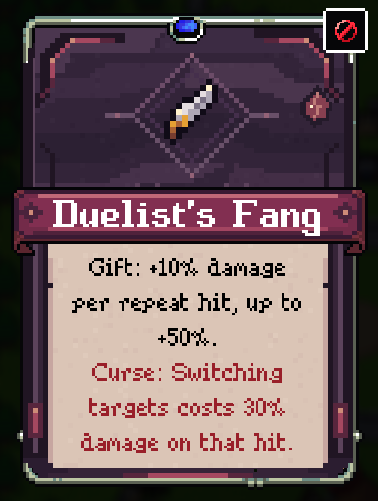
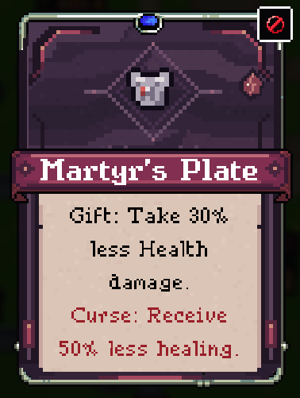
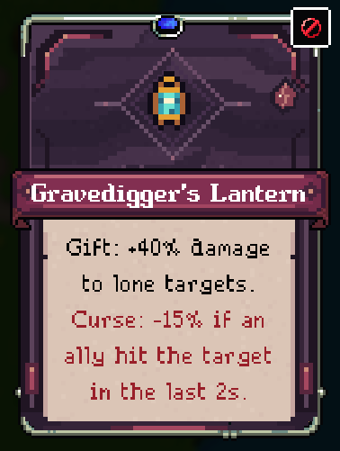
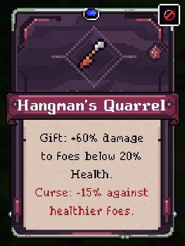
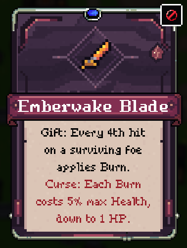
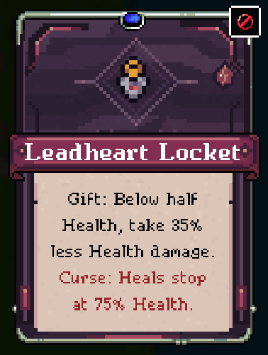
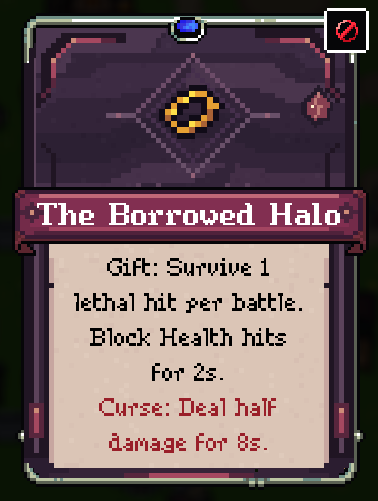

# Cursed Equipment

Ten pieces of cursed equipment join the Blacksmith's stock in Super Fantasy Kingdom. Each gives its wearer an advantage and a drawback. A plum-and-crimson smith's frame identifies cursed offers at a glance.

## Features

- Ten rare items with original pixel-art icons and the same plum-and-crimson frame and title ribbon as Cursed Relics 0.2.8, with native focus and rarity.
- The cards show each Gift and the red Curse together. Rarity markers and prices use the game's usual controls.
- Effects follow the wearer. Copies occupy ordinary equipment slots and their effect applies once.
- Equipped pieces and dropped items persist through the native kingdom save.
- Equipment pairs can work together. Spellglass and Mirror apply their multipliers to the same qualifying hit.

## How to Use

1. Visit the Blacksmith and inspect the Gift and Curse before buying. The ten items join the normal rotating stock.
2. Equip a purchase using the game's item controls. Use the Magnet to remove and redistribute gear.
3. Keep Cursed Equipment enabled when continuing a kingdom containing its items.

## Screenshots

All ten Blacksmith cards appear below at 1.5× UI scale. Each Gift and Curse is also available as selectable text.

### Cracked Spellglass

**Gift** Damaging circles gain 40% radius.

**Curse** Each target takes 20% less damage.

### Bitter Chalice

**Gift** Receive 50% more healing.

**Curse** Heals arrive 3 seconds late.

### Cracked Duelist's Mirror

**Gift** Double the first hit to each monster's health.

**Curse** Later hits deal 25% less.

### Duelist's Fang

**Gift** +10% damage per repeat hit, up to +50%.

**Curse** Switching targets costs 30% damage on that hit.

### Martyr's Plate

**Gift** Take 30% less Health damage.

**Curse** Receive 50% less healing.

### Gravedigger's Lantern

**Gift** +40% damage to lone targets.

**Curse** -15% if an ally hit the target in the last 2s.

### Hangman's Quarrel

**Gift** +60% damage to foes below 20% Health.

**Curse** -15% against healthier foes.

### Emberwake Blade

**Gift** Every 4th hit on a surviving foe applies Burn.

**Curse** Each Burn costs 5% max Health, down to 1 HP.

### Leadheart Locket

**Gift** Below half Health, take 35% less Health damage.

**Curse** Heals stop at 75% Health.

### The Borrowed Halo

**Gift** Survive 1 lethal hit per battle. Block Health hits for 2s.

**Curse** Deal half damage for 8s.

## Compatibility

Cursed Equipment uses the native equipment slots, restrictions, Blacksmith and item saves. Spellglass affects circular projectile searches that deliver native damage effects. Fang, Lantern, Quarrel and Emberwake use unit-sourced hits that reach enemy Health. Burn and other status ticks skip those four effects. Emberwake applies native Burn and requires a living wearer with positive Health.

Plate, Locket and Halo apply to the wearer's remaining Health damage after the wall and Shields. Chalice delays health heals and overheals by three simulation seconds. Losing the last Chalice or dying cancels pending heals. Continue restores equipment and starts a new combat state.

## Installation

1. In Thunderstore Mod Manager, open a Super Fantasy Kingdom profile with BepInEx. Import the local archive, or install Cursed Equipment once the listing is available.
2. Select **Start modded**. For manual installation, place `plugins/CursedEquipment.dll` from the archive in the profile's `BepInEx/plugins` directory.

### Build locally

Run `dotnet build CursedEquipment.csproj -c Release` followed by `python package.py`. Override the default installed paths with `GameDir` and `ProfileDir` when needed.

## Support

[Support GKJ Games on Ko-fi](https://ko-fi.com/gkj_games)
